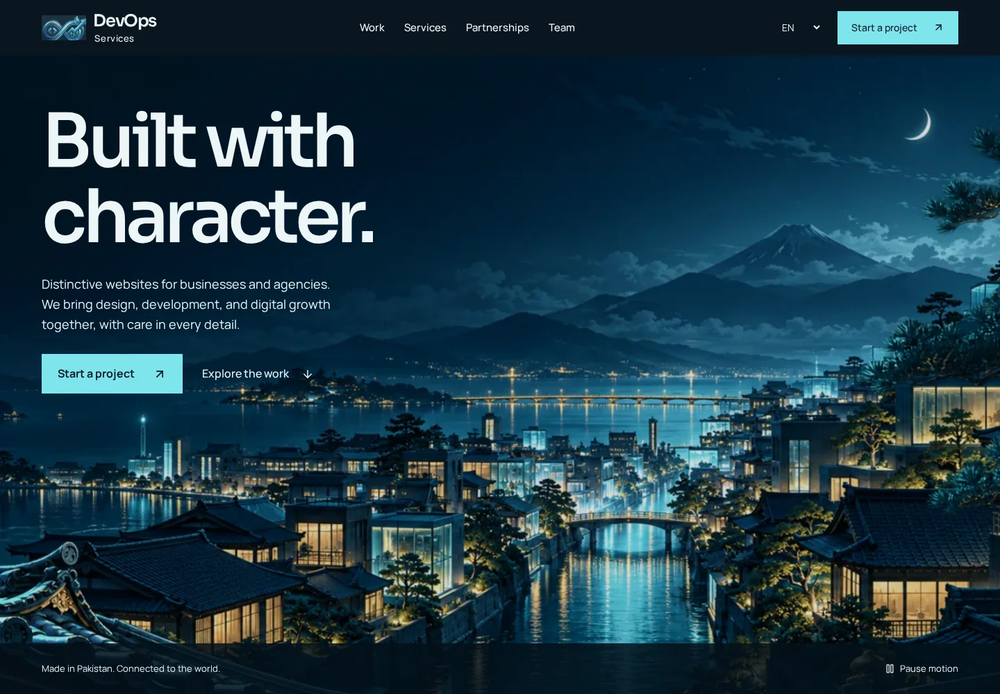

# DevOps Services

**Thoughtful websites. Distinctive experiences. Reliable delivery.**

I built DevOps Services as the online home for my independent web studio. It brings my services, selected projects, creative identity and client inquiries into one place, with a visual direction inspired by Japanese illustration and modern technology.

I’m **Muhammad Soban**, a developer and designer based in Rawalpindi, Pakistan. I work directly with businesses and agencies on websites, frontend development, digital experiences and white-label partnerships.

[Visit the website](https://devopsservices-seven.vercel.app/) · [Explore the work](https://devopsservices-seven.vercel.app/case-studies) · [Meet the team](https://devopsservices-seven.vercel.app/team) · [Start a project](https://devopsservices-seven.vercel.app/#contact)



## The experience

The design follows the company logo’s navy, cyan, ice and gold palette. Four illustrated environments—the city, studio, gallery and harbor—connect the main sections through layered scenery and scroll-driven motion.

The interface keeps the essentials clear: what I do, the work I’ve delivered, how a partnership can work and how to get in touch.

- **Cinematic scrolling:** layered parallax, native sticky sections and a perspective reveal for the featured project.
- **Responsive scenery:** dedicated portrait compositions for key scenes and appropriately sized images for different screen widths.
- **Interactive team profiles:** three 3D characters with scroll and pointer responses, original illustrations and short profile films.
- **Selected work:** individual case studies, category filters, direct project links and reliable Back/Forward navigation.
- **White-label partnerships:** project-based, monthly and weekly engagements with pricing agreed around the scope.
- **Project inquiries:** service selection, USD/PKR budgets for standard projects, contract options, submission feedback and retry handling.
- **Four languages:** English, Japanese, French and German.
- **Motion preferences:** pause controls, reduced-motion support and static character posters when WebGL is unavailable.

The homepage uses lightweight layered imagery. The 3D renderer and character models load only on the team page. Profile films load after activation and pause when they leave the screen.

## Services

My work covers:

- Website and e-commerce development
- Frontend engineering and API integration
- UI/UX design and brand identity
- Website management and ongoing support
- SEO, digital marketing and content
- Business automation and NFC solutions
- White-label development for agencies

## The studio characters

The characters bring personality to the website while keeping the business relationship straightforward.

| Character      | Role                                                                                              |
| -------------- | ------------------------------------------------------------------------------------------------- |
| **Kael Astra** | My creative identity as Muhammad Soban, founder of DevOps Services.                               |
| **Kai Ren**    | The studio’s coding character, representing engineering, problem-solving and attention to detail. |
| **Milo**       | The operations character, representing preparation, resources and organized delivery.             |

Kai and Milo are fictional studio characters. I lead and deliver client projects personally.

## Technology

| Area        | Tools                                             |
| ----------- | ------------------------------------------------- |
| Application | React 19 and TypeScript                           |
| Build       | Vite                                              |
| Styling     | CSS and Tailwind CSS                              |
| Motion      | GSAP, ScrollTrigger and Motion                    |
| 3D          | Three.js and optimized GLB assets                 |
| Typography  | Self-hosted Sora, Manrope and Noto Sans JP        |
| Testing     | Playwright, Chromium and axe accessibility checks |
| Hosting     | Vercel                                            |

## Local development

Use **Node.js 24** and npm to match the deployment environment.

```bash
git clone https://github.com/SobanHaroon/Devopsservices-.git
cd Devopsservices-
npm ci
npm run dev
```

The development server runs at `http://localhost:3000`. The current frontend does not require environment variables.

To preview a production build:

```bash
npm run build
npm run preview
```

## Commands

| Command                | Purpose                                                        |
| ---------------------- | -------------------------------------------------------------- |
| `npm run dev`          | Start the development server                                   |
| `npm run lint`         | Validate TypeScript                                            |
| `npm run build`        | Create the production build in `dist/`                         |
| `npm run preview`      | Serve the production build locally                             |
| `npm test`             | Build and run both browser test suites                         |
| `npm run test:browser` | Check routes, forms, languages, models and accessibility       |
| `npm run test:scenery` | Check scenic scrolling, resizing, motion preferences and films |
| `npm run screenshots`  | Build and capture desktop and mobile screenshots               |
| `npm run model:build`  | Prepare and optimize the character models                      |
| `npm run format`       | Format source files and documentation                          |

## Project structure

```text
src/
  components/studio/   Homepage, team profiles, scenery and inquiry form
  context/             Language state
  data/                Services, translations, team profiles and case studies
  lib/                 Shared utilities and motion preferences
  App.tsx              Routes, metadata and scroll restoration
  studio.css           Shared studio styles
  cinematic.css        Scenic compositions and responsive behavior
public/
  media/               Scenery, portraits, films and project images
  models/              Optimized runtime character models
  fonts/               Font assets and licenses
assets/
  characters/          Character source assets
  source-vectors/      Compressed SVG source files
docs/                  Design, scenery and testing notes
scripts/               Browser checks, captures and asset preparation
```

## Motion and performance

Scrolling stays native. The cinematic sections follow scroll position without intercepting the mouse wheel or replacing browser scrolling. On short viewports, the scenes use normal document flow so their controls remain reachable.

Images use responsive WebP sources. The opening scene loads immediately; later scenery and posters load as needed. Animation contexts, observers and 3D resources are cleaned up when a view is left.

The motion controls and the device’s reduced-motion preference provide a quieter presentation without removing content. Changing that preference while the site is open updates the scenery immediately.

## Testing

Install Chromium before running the browser suites:

```bash
npx playwright install chromium
npm test
```

For an existing Chromium installation, set `PLAYWRIGHT_CHROME` to its executable path.

The checks cover navigation, direct routes, browser history, case-study filtering, mobile menus, inquiry validation and delivery states, four-language layouts, character interactions and accessibility. The scenery suite also checks reversible scroll progress, responsive image selection, resizing, landscape layouts and video playback behavior.

Responsive checks cover widths from **320px to 1920px**, including a landscape-phone viewport. Browser tests run in Chromium. Screenshots and test results are written to the ignored `artifacts/` directory. Form requests are intercepted during testing, so the tests do not send live inquiries.

## Contact form

The current form sends inquiries through the notification transport configured in `src/components/studio/ProjectContact.tsx`. It includes a submission timeout, duplicate-submit protection, error recovery and a success receipt.

White-label inquiries include the selected contract basis and **Contract based** pricing. Standard project inquiries retain their service selection and budget.

The current notification topic is public. A private production CRM or confidential lead workflow should use an authenticated server endpoint and durable storage.

## Deployment

This repository deploys to the existing **devopsservices** Vercel project.

1. Install dependencies with `npm ci`.
2. Run `npm run lint` and `npm test`.
3. Push the reviewed release to `main`.
4. Confirm the production deployment and check the homepage, team profiles and case-study routes.

`vercel.json` defines the Vite build, `dist/` output, SPA route fallback, asset caching and response headers. Direct links such as `/team#kai` and `/case-studies/atelier-noir` must continue working after a refresh.

## Contact

For a website, ongoing development support or a white-label partnership, [send me a project brief](https://devopsservices-seven.vercel.app/#contact).

**Muhammad Soban** · Founder, DevOps Services

[Portfolio](https://muhammadsoban.vercel.app/) · [GitHub](https://github.com/SobanHaroon)
