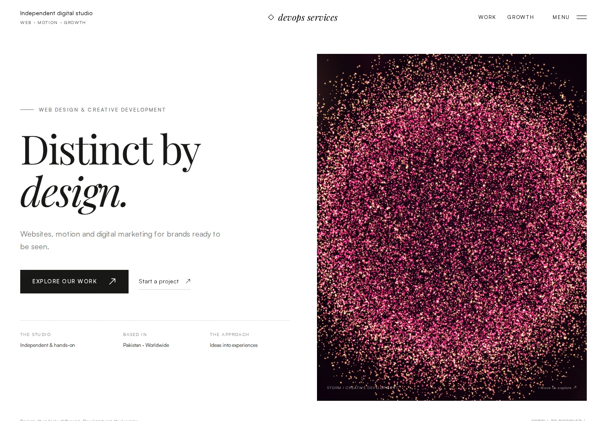

# DevOps Services

**Websites, motion and digital marketing for brands ready to be seen.**

DevOps Services is the independent digital practice of Muhammad Soban, based in Rawalpindi, Pakistan and working with businesses and agencies worldwide.

[Website](https://devopsservices-seven.vercel.app/) · [Selected work](https://devopsservices-seven.vercel.app/case-studies) · [Digital marketing](https://devopsservices-seven.vercel.app/digital-marketing) · [Start a project](https://devopsservices-seven.vercel.app/#contact)



## The experience

An editorial visual system pairs Playfair Display and Satoshi with monochrome surfaces, dashed rules and asymmetric project spreads. Colour comes from the work itself, the interactive Storm and the moving desert landscape.

- **Interactive Storm:** 50,000 additive particles, a crimson-to-gold radial palette, cursor repulsion, camera parallax and a scroll-driven dive.
- **Selected work:** five individual website case studies with the brief, approach, features, gallery and delivered scope.
- **Digital marketing:** eight films grouped into dedicated sections for Babay Dee Atta Chakki, Cielo Noir, DevOps Services and Muhammad Soban.
- **Continuous media:** every displayed video autoplays muted, loops and plays inline without playback controls. Portrait and 4:5 reels keep their original proportions.
- **Editorial motion:** smooth scrolling, heading entrances, on-scroll reveals and image parallax. Reduced-motion preferences simplify interface transitions; the explicitly continuous media remains playing.
- **Project inquiries:** service selection, USD/PKR project budgets, contract-based white-label options and visible delivery/retry states.
- **Responsive navigation:** keyboard-accessible full-screen menu, direct routes, campaign anchors and browser history.

The studio is described as an independent practice. The previous fictional team presentation has been removed; existing `/team` links redirect to the studio introduction.

## Run locally

Use Node.js 24 and npm.

```bash
npm ci
npm run dev
```

The Vite development server uses port 3000. In environments that only expose loopback interfaces, use `npx vite --host 127.0.0.1 --port 3000`.

```bash
npm run lint       # TypeScript validation
npm run build      # Production files in dist/
npm run preview    # Preview the production build
```

## Browser checks

Install Chromium, or point `PLAYWRIGHT_CHROME` at an existing compatible browser:

```bash
npx playwright install chromium
npm test
```

The browser suite starts its own local static server and checks real navigation, campaign anchors, video decoding and looping, the Storm interactions, inquiry validation/retry states and responsive layouts. It saves screenshots and audit results under the ignored `artifacts/editorial/` directory. Form requests are intercepted; tests do not send live inquiries.

## Project structure

```text
src/
  components/editorial/   Storm embed, looping media, motion and marketing page
  components/studio/      Header, homepage, footer, inquiry form and work cards
  components/             Case-study archive and detail views
  data/                   Project, campaign and inquiry copy
  context/                Inquiry language preference
  lib/                    Project brief formatting and metadata
  App.tsx                 Routing and browser-history handling
  editorial.css           Responsive editorial design system
public/
  scenes/storm/index.html  Standalone procedural Storm
  vendor/three-r143/       Pinned Three.js modules used by the embedded scene
  media/reels/             Eight optimized reels, posters and source mapping
  media/desert/            Desert film and poster
  media/work/              Existing project imagery
  fonts/                  Local Satoshi and Japanese font files
scripts/
  check-editorial.mjs      Browser verification and screenshot capture
  local-server.mjs         Static test server
```

## Storm scene

`public/scenes/storm/index.html` is a standalone HTML scene with inline shaders and application code. Opening it normally uses the specified Three.js r143 unpkg import map. The website embeds it with `?embedded=1&local=1`, using the same pinned modules served locally and receiving scroll/pointer input from its parent.

The scene preserves the supplied constants, geometry, shaders and three-composer rendering order. A black one-pixel texture explicitly represents the unused halo. The embedded mode removes the standalone scroll host; the homepage supplies scroll progress instead. A lightweight animated fallback appears when WebGL cannot initialize.

## Campaign media

The supplied masters remain the source material. Web copies are H.264, 720 pixels wide, 30 fps, silent and optimized for progressive playback; durations and aspect ratios are preserved. The desert loop is 1920 pixels wide at 24 fps. `public/media/reels/manifest.json` maps the original filenames to their published paths.

Browsers and operating systems can still restrict autoplay or suspend background tabs. The site requests muted playback on load and retries when media is ready, the page becomes visible or a visitor interacts. It does not intentionally pause offscreen reels or provide playback buttons.

## Inquiry delivery

The existing form posts to its configured notification transport in `ProjectContact.tsx`, with a timeout, duplicate-submit protection, error recovery and success receipt. White-label enquiries support project, monthly and weekly contracts; standard enquiries retain their service selection and project budget.

The inquiry form is available in English, Japanese, French and German. The surrounding editorial site is in English. The existing notification topic is public; a confidential production lead workflow requires an authenticated server endpoint and durable storage.

## Deployment

The repository is connected to the existing **devopsservices** Vercel project. Vercel builds with `npm run build` and publishes `dist/`. `vercel.json` defines the SPA fallback, legacy team redirect and response headers.

Validate the release with TypeScript and browser checks, push it to the connected production branch, then confirm the Vercel deployment. Direct URLs for `/digital-marketing` and `/case-studies/:slug` must load on refresh.

## Contact

[Send a project brief](https://devopsservices-seven.vercel.app/#contact) · [Instagram](https://www.instagram.com/devopsservicesltd/) · [Muhammad Soban](https://muhammadsoban.vercel.app/)
